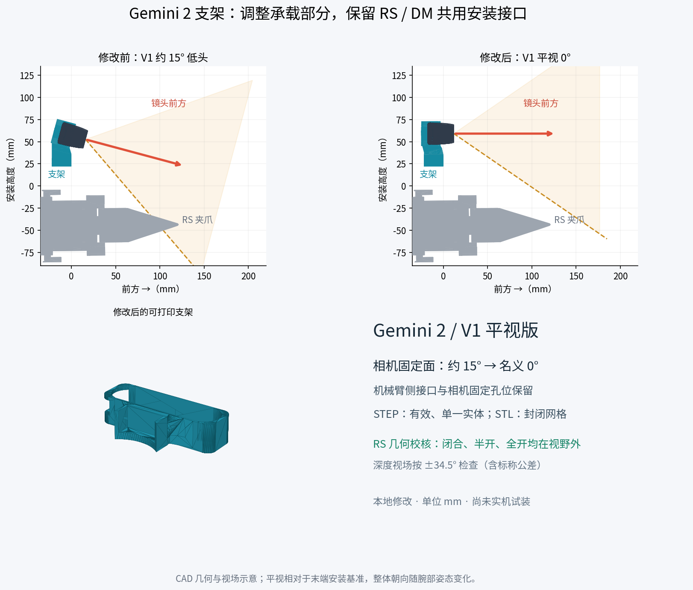

# reBot RS Camera Follow

基于腕部深度相机的 B601-RS 机械臂手掌跟随与夹爪控制项目。相机识别手掌位置，程序结合深度和机械臂运动学计算跟随指令；本地网页提供相机预览、关节状态、速度设置和真机控制。

## 致谢

感谢 [TonyWeyyy / Rebot_B601_RS_CV_Control](https://github.com/TonyWeyyy/Rebot_B601_RS_CV_Control) 提供的思路。

机械臂控制使用 [LAN-GER / rebot_control](https://github.com/LAN-GER/rebot_control)；网页模型使用 [Yang-Ci / ReBot_Arm_DigitalTwin_RS](https://github.com/Yang-Ci/ReBot_Arm_DigitalTwin_RS) 的数字孪生资源。相机支架来源及许可见[支架说明](models/wrist_camera/gemini2-v1-level/README.txt)和[模型说明](models/wrist_camera/README.md)。

## 功能

- 支持 Gemini 2、Gemini 336 和 RealSense D435i 的手掌视觉跟随；相机和机械臂的适配要求见下方说明。
- 通过手部关键点和深度图获取三维掌心位置，经过滤波、坐标变换和运动学计算生成机械臂指令。
- 支持拇指、食指捏合控制夹爪，也可以选择保持夹爪当前位置。
- 本地网页可预览相机与深度图、显示关节状态和三维模型，并调整跟随增益及速度。
- HOME 到位后可按 `R`、点击网页按钮，或持续张开手掌 3 秒开始跟随。

## 工作原理

```text
腕部相机                 视觉处理                          机械臂控制
RGB 图像 ───────┐    手掌关键点 ── 掌心像素 ──┐
               ├──→                         ├──→ 三维目标 ─→ 滤波与预测
对齐深度图 ─────┘    掌心附近深度采样 ────────┘                 │
                                                               ↓
              CAN ←── 关节速度 / 位置指令 ←── 雅可比逆解 ←── 坐标变换与伺服

手指关键点 ─→ 拇指 / 食指距离 ─→ 滤波与开合映射 ─→ 夹爪指令
本地网页   ─→ 控制程序启停、参数设置；接收状态并显示相机 / 机械臂模型
```

视觉线程负责相机取帧、手掌识别和深度采样；伺服线程读取最新目标，结合机械臂运动学计算关节指令。夹爪与手掌跟随共用手部检测结果。网页通过本机服务管理控制程序，并显示反馈、指令或估算状态；显示来源以页面标识为准。

## 项目结构

```text
reBot_RS_Camera-Follow/
├── palm_follow_grasp.py           # 手掌跟随与捏合抓取主入口
├── gemini2_camera.py              # Gemini 相机采集与对齐深度
├── realsense_camera.py            # RealSense 相机采集
├── rebot_adapter.py               # 机械臂控制库、运动学与 CAN 适配
├── web_camera_preview.py          # 网页彩色画面及深度小窗
├── config/                        # 跟随、夹爪、HOME 和标定配置
│   ├── follow.yaml                # 通用跟随参数
│   ├── follow_gemini336.yaml      # Gemini 336 默认叠加参数
│   ├── grasp.yaml                 # 捏合到夹爪的映射
│   ├── home_pose.json             # HOME 关节位置
│   ├── joint_offset.json          # 关节零位修正
│   └── hand_landmarker.task       # MediaPipe 手部识别模型
├── robot_follow/                  # 主程序按职责拆分的模块
│   ├── configuration/             # 参数加载、覆盖与校验
│   ├── perception/                # 手掌检测、深度采样与跟踪
│   ├── control/                   # 滤波、视觉伺服、运动学与保护
│   ├── hardware/                  # 相机、运动学和硬件接口
│   ├── runtime/                   # 视觉循环、HOME、反馈与遥测
│   └── presentation/              # 本地画面和诊断展示
├── web/                           # 本地网页、控制服务和状态显示
│   ├── server.py                  # 网页服务与 API
│   ├── robot_process.py           # 真机控制进程和相机预览管理
│   ├── app.js / index.html / style.css
│   └── README.md                  # 网页使用与数据来源说明
├── assets/                        # RS 机械臂和腕部相机模型资源
├── vendor/rebot_control/          # 集成的机械臂控制器
├── models/wrist_camera/           # 相机模型、支架和许可证
│   ├── gemini2-v1-level/          # 平视支架的 STEP、STL、预览与说明
│   ├── gemini336.urdf             # Gemini 336 腕部模型
│   ├── meshes/                    # 相机和现有支架网格
│   └── source/  licenses/         # 原模型与许可
├── tools/                         # 标定、诊断和回归测试入口
├── tests/                         # 不连接真实机械臂的自动化测试
├── docs/                          # 技术手册与历史文档
├── requirements.txt               # 真机及视觉运行依赖
├── requirements-test.txt          # 离线回归依赖
└── requirements-d435i.txt         # D435i 视觉依赖
```

### 主要模块

| 位置 | 职责 |
| --- | --- |
| [`robot_follow/perception/`](robot_follow/perception/) | 手部关键点、掌心跟踪、深度处理、相机标定检查 |
| [`robot_follow/control/`](robot_follow/control/) | 三维目标滤波、视觉伺服、夹爪映射、运动学与桌面保护 |
| [`robot_follow/runtime/`](robot_follow/runtime/) | 启动和 HOME、视觉循环、运行状态、反馈采样与遥测 |
| [`robot_follow/hardware/`](robot_follow/hardware/) | 相机会话、运动学和硬件接口抽象 |
| [`web/`](web/) | 网页控制、相机预览、机械臂状态与模型展示 |
| [`tools/`](tools/) 和 [`tests/`](tests/) | 标定、诊断、假设备测试和回归脚本 |

## Gemini 2 V1 平视支架

[支架文件夹](models/wrist_camera/gemini2-v1-level/)包含四个文件：

| 文件 | 用途 |
| --- | --- |
| [Gemini2_V1_Level.step](models/wrist_camera/gemini2-v1-level/Gemini2_V1_Level.step) | 可编辑 CAD 模型，单位 mm |
| [Gemini2_V1_Level.stl](models/wrist_camera/gemini2-v1-level/Gemini2_V1_Level.stl) | 可切片的打印模型，单位 mm |
| [Gemini2_V1_Level_preview.png](models/wrist_camera/gemini2-v1-level/Gemini2_V1_Level_preview.png) | 修改前后及夹爪视场示意 |
| [README.txt](models/wrist_camera/gemini2-v1-level/README.txt) | 尺寸、几何校核和来源说明 |

该平视版支架基于 Seeed 的 V1 模型，将相机固定面从约 15° 下倾调整为名义 0°。支架由 Gemini 2、Gemini 336 和 D435i 共用；相机的实际固定方式、光学方向与视野应在装配后核对。预览图中的视场结果基于 Gemini 2 的 CAD 几何校核，**尚未完成实物试装和相机画面验证**，不能代表其他相机的实测视场。

Gemini 2、D435i 和 Gemini 336 共用 V1 平视支架，网页和跟随程序使用各自对应的平视版 URDF；相机光学中心按型号分别设置。模型使用 CAD 名义装配，实际安装应在首次运行前核对，详见[腕部模型说明](models/wrist_camera/README.md)。



## 环境与安装

项目面向 Linux 实机环境。真机运行需要已配置的机械臂、CAN 接口、深度相机及其 SDK，以及运动学和视觉依赖。不同机器的 Python、系统库和设备权限可能不同。

```bash
git clone https://github.com/Yang-Ci/reBot_RS_Camera-Follow.git
cd reBot_RS_Camera-Follow
```

安装离线测试依赖：

```bash
python3 -m venv .venv
.venv/bin/python -m pip install -r requirements-test.txt
```

真机程序使用 `.venv-arm`，参考环境为 Python 3.10，并需要 `requirements.txt` 中的依赖以及可用的相机 SDK、Pinocchio 和 motorbridge。可在满足系统依赖的机器上创建环境：

```bash
python3.10 -m venv .venv-arm
.venv-arm/bin/python -m pip install -r requirements.txt
```

机械臂控制库、RS URDF、网页模型和浏览器手部识别资源均包含在本仓库中，无需克隆其他项目或设置资源路径。Python 依赖和相机 SDK 仍需按上面的说明安装。资源来源见 [资源说明](assets/README.md)。

可选的 ROS 标定客户端需要现有 ROS 控制器及其消息接口；使用该模式时，将 `REBOT_ROS_ENV` 指向已配置的 ROS 环境 `setup.bash`。普通跟随和网页功能不依赖 ROS。

仓库内的 HOME、零位和标定数据对应原设备，**不能直接假定适用于另一台机械臂或新的相机安装**。连接真机前，应检查 CAN、关节零位、HOME、手眼标定、夹爪配置和工作空间。

## 启动网页

```bash
python3 web/server.py
```

打开 <http://127.0.0.1:8765>。网页本身可以在不连接机械臂时打开。选择已连接的 Gemini 2、Gemini 305、Gemini 336 或 D435i 并打开相机后，可先检查画面，再选择速度、夹爪模式和参数。选择会同步切换对应相机模型与控制配置。各相机默认使用对应 URDF 的名义位姿，无需手眼文件；位姿应与实际安装一致，运动方向须先低速核对。Gemini 305 使用居中平视支架的 CAD 名义位姿。

网页的“HOME 位姿”可通过重力手推示教、实际反馈填入或手动输入来保存和选择多人的 HOME。重力示教会使能电机，需扶持机械臂并准备硬件急停，尚未完成本项目实机验收。个人数据仅保存在本机；详见[网页说明](web/README.md)。

点击“初始化真机”会使能机械臂并移动到 HOME；到位后按 `R`、点击“开始跟随”，或持续张开手掌 3 秒开始。空格暂停；`Q` / `Esc` 请求退出并回零。初始化、退出和回零都可能产生真实运动，紧急情况使用硬件急停。

网页预设中，低速验证使用增益 1.5 / 1.5、末端速度上限 0.10 m/s；中速验证使用增益 1.9 / 1.9、速度上限 0.25 m/s。参数可在初始化前调整，具体设置和操作见[网页说明](web/README.md)。

仅进行 Gemini 336 视觉预览、不连接机械臂：

```bash
.venv-arm/bin/python palm_follow_grasp.py --camera gemini336 --no-arm
```

D435i 使用、手眼标定和更详细的控制说明见[技术手册](docs/技术手册.md)与[定稿技术文档](docs/B601手掌跟随系统_定稿技术文档.md)。历史文档中的参数应以当前配置和代码为准。

## 配置文件与命令参数

| 文件 | 作用 |
| --- | --- |
| [`config/follow.yaml`](config/follow.yaml) | 跟随距离、增益、速度、滤波、工作空间与日志参数 |
| [`config/follow_gemini336.yaml`](config/follow_gemini336.yaml) | 默认 Gemini 336 运行时叠加的稳定参数 |
| [`config/grasp.yaml`](config/grasp.yaml) | 捏合距离、夹爪开合、滤波和运动中保持设置 |
| [`config/home_pose.json`](config/home_pose.json) | 初始化时使用的 HOME 关节位置 |
| [`config/joint_offset.json`](config/joint_offset.json) | 关节零位修正 |
| `config/follow_v*_fallback.yaml` | 保留的历史参数配置，可用于对照 |

默认读取 `follow.yaml`；选择 Gemini 336 且未指定自定义跟随配置时，再叠加 `follow_gemini336.yaml`。命令行参数可覆盖对应运行参数；网页选择速度档位或填写增益、速度只影响本次启动，不写入 YAML。

```bash
# 仅识别 Gemini 336 画面，不连接机械臂
.venv-arm/bin/python palm_follow_grasp.py --camera gemini336 --no-arm

# 查看可用参数
.venv-arm/bin/python palm_follow_grasp.py --help
```

常用参数包括 `--camera`、`--distance`、`--gain`、`--gain-x`、`--max-vel`、`--fps` 和 `--follow-cfg`。`--no-arm` 只运行视觉；`--no-gripper` 关闭捏合控制；`--no-follow` 用于仅夹爪模式。后两种模式仍会连接机械臂，启动前应先检查设备和工作空间。

## 标定与诊断工具

| 工具 | 用途 |
| --- | --- |
| [`tools/teach_home.py`](tools/teach_home.py) | 示教 HOME 位置 |
| [`tools/auto_calibrate_camera.py`](tools/auto_calibrate_camera.py) | Gemini 2、Gemini 336 和 D435i / D430i 标记预览与手眼标定 |
| [`tools/gripper_j7_calibrate.py`](tools/gripper_j7_calibrate.py) | J7 夹爪开合标定 |
| [`tools/analyze_servo_log.py`](tools/analyze_servo_log.py) | 分析伺服诊断日志 |
| [`tools/run_regression.py`](tools/run_regression.py) | 顺序运行假设备回归 |

Gemini 2、D435i、Gemini 305 和 Gemini 336 默认使用各自 URDF 的名义相机位姿，无需手眼标定文件。Gemini 2、D435i 与 Gemini 336 使用对应的 V1 平视版模型；D435i 根据当前彩色或红外图像选择光学坐标。URDF 位姿须与实际支架和相机安装一致；它不计算关节零位，`config/joint_offset.json` 继续用于运动学。通用手眼标定工具是可选诊断工具，`--run` 会使能并移动机械臂；已有结果不会被覆盖。

```bash
# 只查看标记画面，不连接机械臂；型号也可选 gemini336 或 d435i
.venv-arm/bin/python tools/auto_calibrate_camera.py --camera gemini2 --preview

# 查看完整选项（--run 会驱动机械臂）
.venv-arm/bin/python tools/auto_calibrate_camera.py --help
```

部分标定命令会连接或驱动机械臂；运行前先阅读工具帮助和[技术手册](docs/技术手册.md)，确认现场条件。控制程序及诊断日志默认保存在本地 `logs/`，不会提交到仓库。

## 跟随与安全

短时手掌丢失按原跟随逻辑做有限外推，较长时间丢失时保持；重新识别后可能自动继续。深度丢失使用原有深度冻结与超时处理。Gemini 336 桌面跟随保留关节反馈和桌面高度软件保护，详细条件见[网页说明](web/README.md)。

这些保护依赖模型、标定和反馈，不能代替碰撞检测或硬件急停，也不能保证 HOME、回零、夹持物和整条机械臂的安全。首次运行或更换硬件后，应清空工作区、确认急停可用，并从低速开始验证。

## 测试

不连接真实机械臂的核心回归：

```bash
.venv/bin/python tools/run_regression.py
```

包含 Node.js 浏览器策略测试的扩展回归：

```bash
.venv/bin/python tools/run_regression.py --extended
```

这些测试使用假设备，不能替代现场安装、相机标定和低速实机验证。日志保存在本地 `logs/`，默认不提交到仓库。
